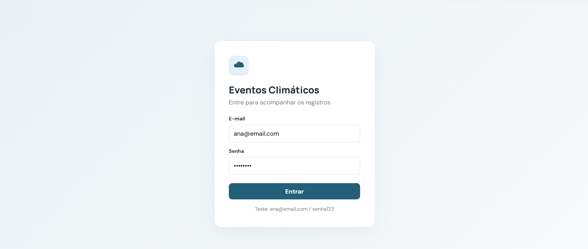
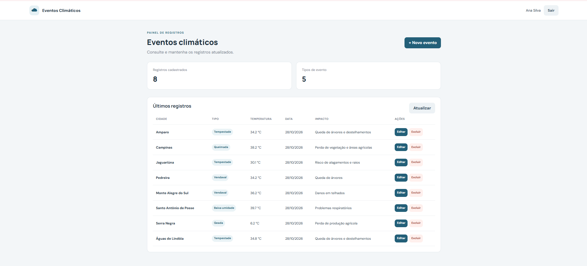
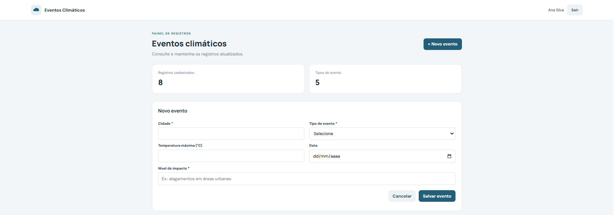

# Eventos Climáticos

Projeto desenvolvido para a atividade da aula 05 de PSOF3. A aplicação permite entrar com um usuário de teste e cadastrar, consultar, editar e excluir eventos climáticos.

## Tecnologias
- Node.js e Express
- Prisma ORM
- MySQL
- HTML, CSS e JavaScript

## Como executar

### 1. Banco de dados
Instale/abra o MySQL pelo XAMPP e crie um banco chamado `eventos`.

### 2. Backend
Abra o terminal na pasta `api` e execute:

```bash
npm install
```

Copie `.env.example` para `.env` e confira os dados de conexão com o MySQL. Depois execute:

```bash
npx prisma generate
npx prisma migrate dev --name init
npx prisma db seed
npm run dev
```

A API ficará disponível em `http://localhost:3000`.

### 3. Front-end
Com o backend em execução, abra `web/index.html` no navegador. Se necessário, altere a URL da API no início do arquivo `web/app.js`.

## Usuários para teste
- ana@email.com
- maria@email.com
- joao@email.com
- paula@email.com
- pedro@email.com

Senha para todos: `senha123`

## Rotas principais
- `POST /usuario/login` — login
- `GET /usuario` — listar usuários
- `GET /evento` — listar eventos
- `GET /evento/:id` — consultar evento
- `POST /evento` — cadastrar evento
- `PUT /evento/:id` — editar evento
- `DELETE /evento/:id` — excluir evento

## 📸 Imagens do sistema

### Tela de login


### Tela inicial


### Área de cadastro



